# Comparing Models for Glioma Grade Classification

**DSC 201 - Project 2 | Tarun Vigneswaran**

## 1. Introduction

This project compares Logistic Regression, Random Forest, AdaBoost, and XGBoost
using the approved UCI Glioma Grading Clinical and Mutation Features dataset.
The original file has 839 records and 23 input features: 20 gene-mutation features
and three clinical features (age, gender, and race). The target is Grade:
0 means Lower-Grade Glioma (LGG), and 1 means Glioblastoma (GBM).
We predict the dataset's grade labels among glioma records, not whether a person has cancer.
This is an educational comparison, not a medical diagnostic system.

## 2. Data exploration and preprocessing

The original data contains 487 LGG and 352 GBM records. There are no missing
values, so no values were filled in. There is one exact repeated record. I kept
the first copy and removed the repeat before splitting, leaving 838 records:
486 LGG and 352 GBM. Without patient IDs, I cannot prove those two records were
the same person. Removing the repeat avoids identical records appearing in both
training and testing, but it could remove a different person with matching values.
The downloaded CSV stays unchanged.

Age ranges from 14.42 to 89.29 years. The 1.5-times-IQR check flags no ages in
the prepared data, so none were removed or changed. The original median age is
41.61 for LGG and 61.395 for GBM. GBM cases tend to be older here, but the ranges
overlap. Age alone cannot separate the groups perfectly.

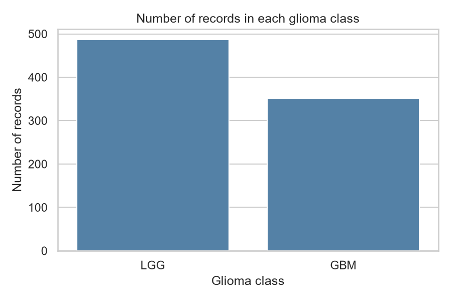

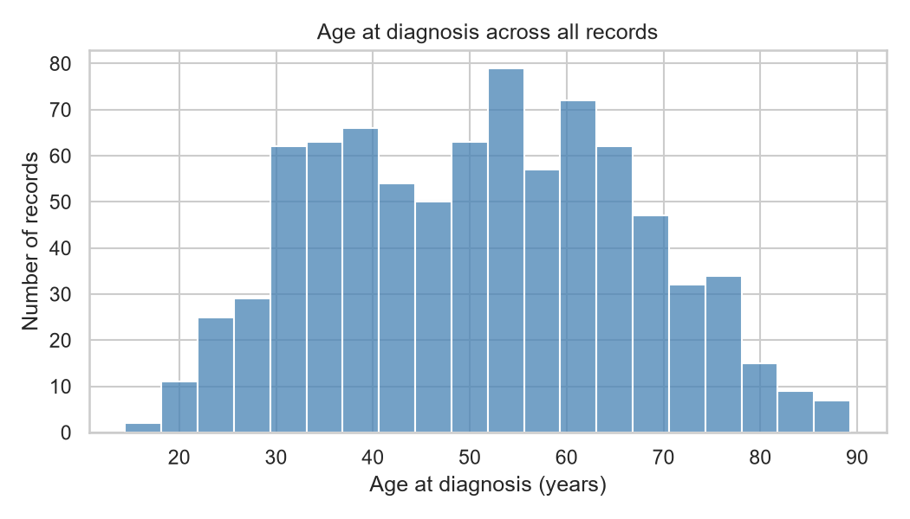

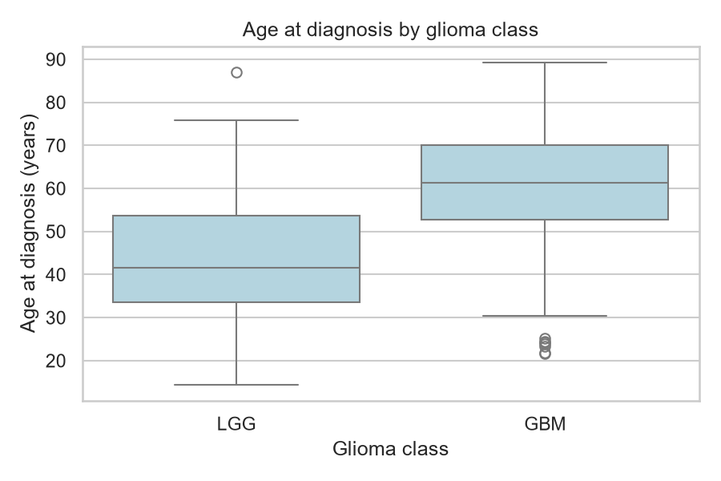

The five most frequently mutated genes are IDH1 (404 records), TP53 (348),
ATRX (217), PTEN (141), and EGFR (112). Frequency is not the same as predictive
importance. All 20 gene features were kept. In the original file, IDH1 and Grade
have a correlation of about -0.708, while age and Grade have a correlation of
about 0.529. These describe this sample and do not prove cause and effect.

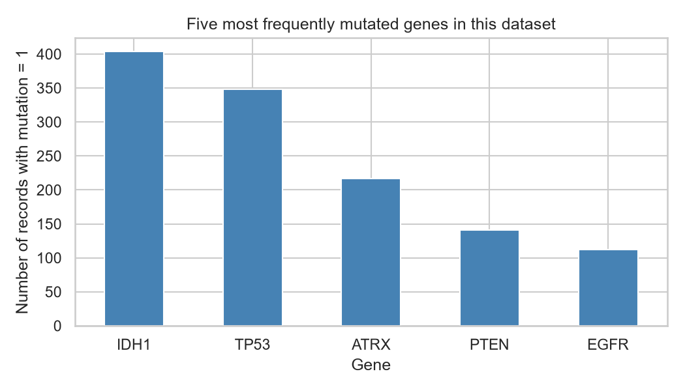

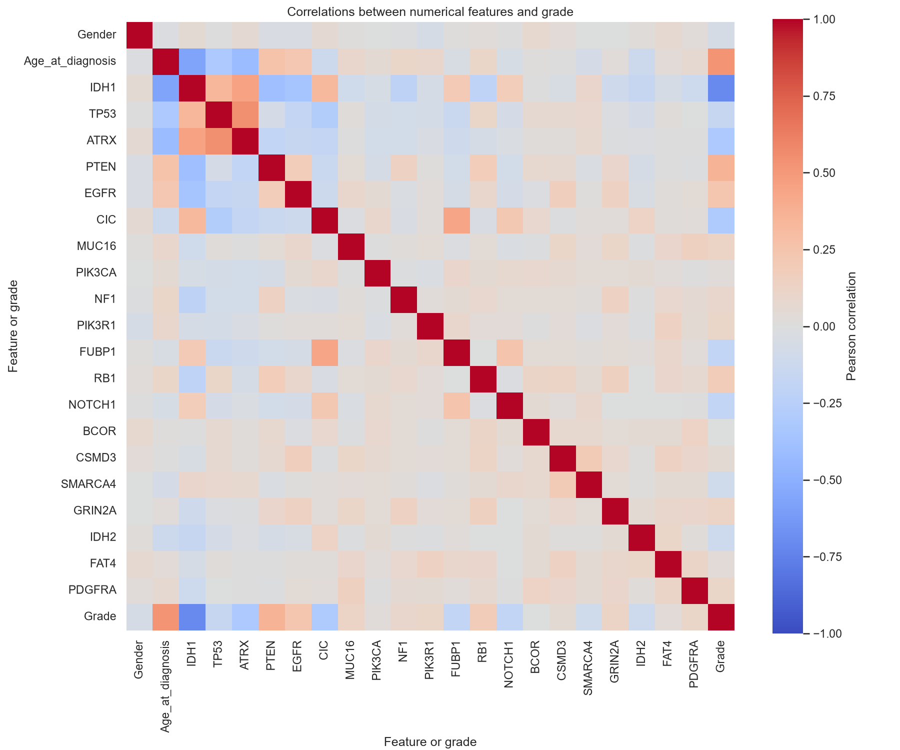

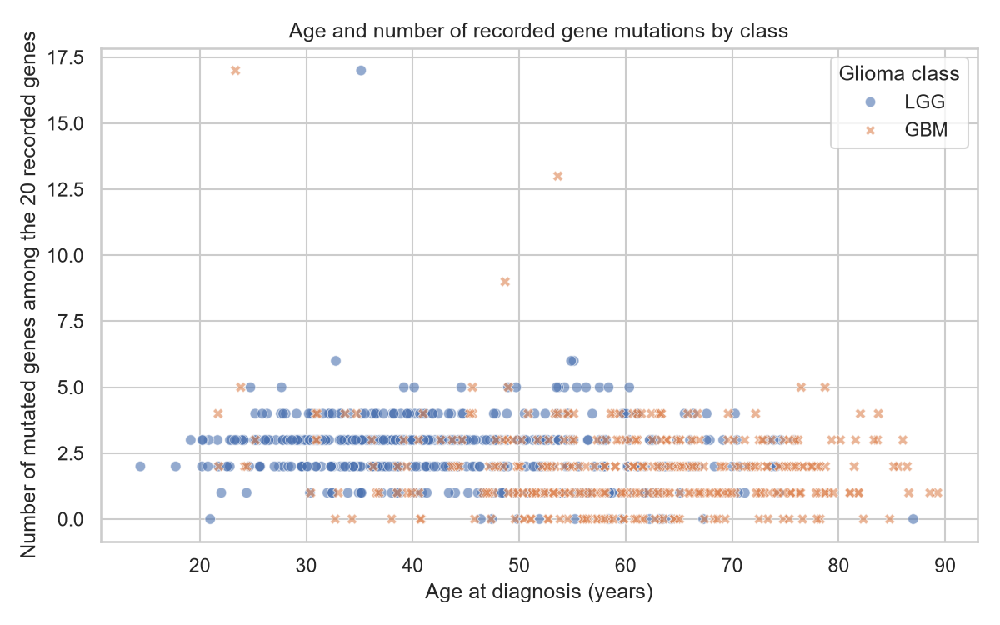

The scatter plot shows age and the number of mutations among the 20 recorded
genes. This count is used only for the plot, not added as a model feature.
The two classes overlap in the chart.

Race arrives as four text labels, even though UCI's variable description lists
number codes. Each race category becomes a separate yes/no column, avoiding an
artificial numerical order. The category list comes from UCI rather than learned
test outcomes. There are 26 numeric input columns after encoding the original
23 features. Gender and the genes already use 0 and 1. Grade is never an input.

The reusable split function reserves 20% for testing, keeps similar class
proportions, and accepts a reproducible seed. It also supports optional
training-only standardization. For model searches, I leave that option off and
put scaling inside the Logistic Regression pipeline. Each CV training fold
therefore learns its own scaling values. Tree models do not need scaling.

## 3. Models and tuning

- **Logistic Regression:** learns a weighted rule for GBM. I tuned C (0.1, 1, 10),
  which controls how strongly large coefficients are limited.
- **Random Forest:** combines many decision trees. I tuned the tree count
  (50, 100) and maximum depth (5 or unlimited).
- **AdaBoost:** adds small trees and gives more weight to difficult cases.
  I tuned the tree count (30, 60) and learning rate (0.1, 0.5).
- **XGBoost:** adds trees to improve earlier predictions. I used 50 trees and
  tuned maximum depth (2, 3) and learning rate (0.05, 0.1).

Each grid has three or four combinations. All models use GridSearchCV with the
same five shuffled stratified folds and F1 as the tuning score. GBM (1) is the
positive class. Precision asks how many predicted GBM cases were correct;
recall asks how many actual GBM cases were found. F1 balances precision and recall.
Undefined precision or recall is set to zero using zero_division=0.

For each seed from 100 to 129, I made a new stratified 80/20 split: 670 training
records and 168 test records. All four models used the same people and folds
within each repetition. The search used training data only, then automatically
refitted its best pipeline on the whole training set. Test scores were calculated
after that. The complete search was repeated 30 times, not tuned once and reused.

## 4. Evaluation and visualization

The following are held-out test scores for all features, on a 0-1 scale.
The values after +/- are sample standard deviations across the 30 repetitions.

| Model | Accuracy (mean +/- SD) | Precision (mean +/- SD) | Recall (mean +/- SD) | F1 (mean +/- SD) |
| --- | --- | --- | --- | --- |
| Logistic Regression | 0.8706 +/- 0.0211 | 0.8078 +/- 0.0329 | 0.9131 +/- 0.0312 | 0.8566 +/- 0.0219 |
| Random Forest | 0.8655 +/- 0.0194 | 0.7996 +/- 0.0284 | 0.9117 +/- 0.0327 | 0.8514 +/- 0.0208 |
| AdaBoost | 0.8633 +/- 0.0205 | 0.7860 +/- 0.0303 | 0.9319 +/- 0.0240 | 0.8523 +/- 0.0201 |
| XGBoost | 0.8641 +/- 0.0182 | 0.7916 +/- 0.0273 | 0.9230 +/- 0.0307 | 0.8517 +/- 0.0187 |

Logistic Regression had the highest mean F1, 0.8566, and mean
accuracy 0.8706. For context, always predicting LGG
would give 97/168 = 0.5774 accuracy in these test splits, but zero GBM recall.
Accuracy alone would not show that failure to identify GBM.

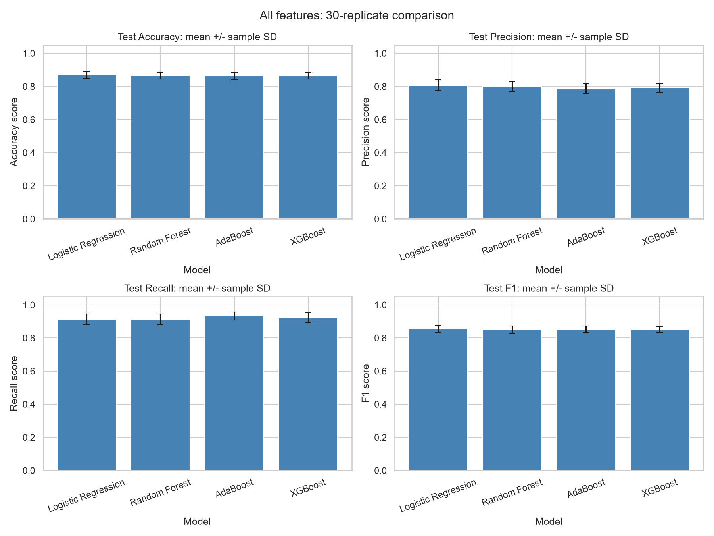

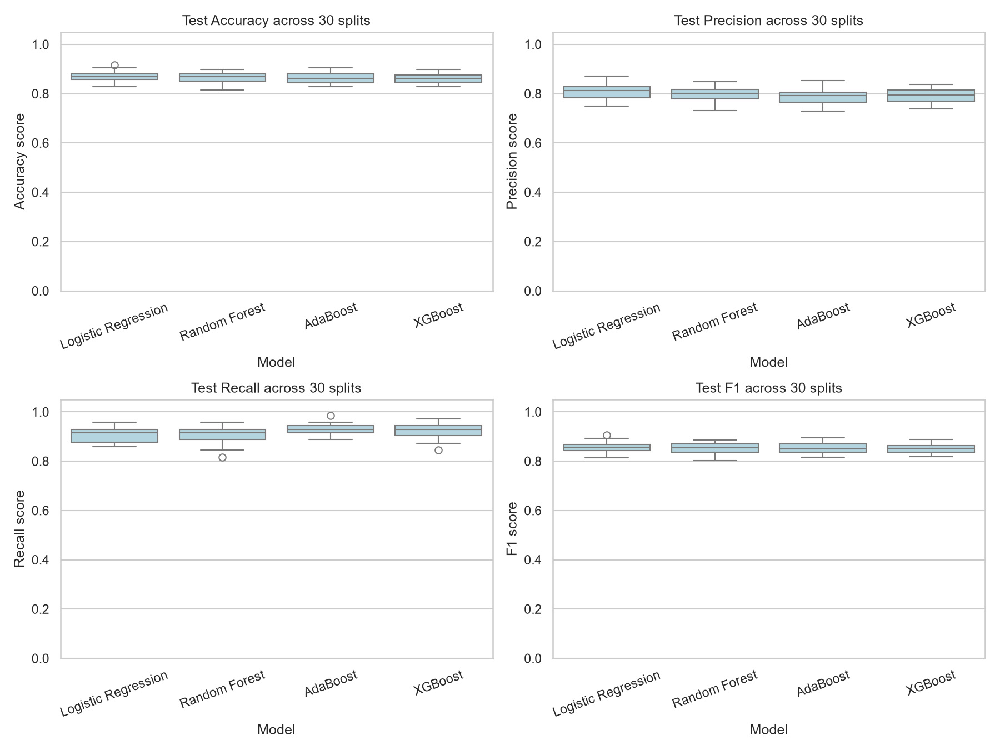

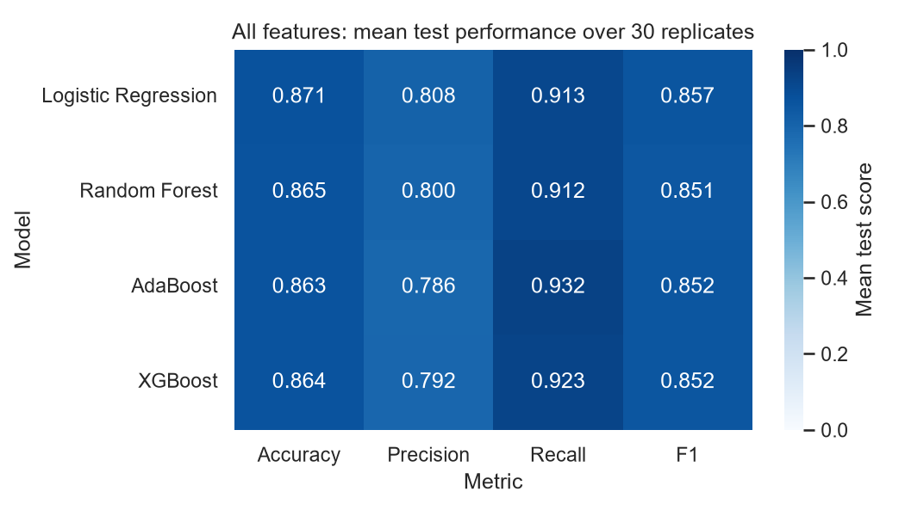

The bar charts show averages and SD. The box plots show how scores change
between splits. The heatmap summarizes the average scores. Minimum and maximum
scores show the observed range, not guaranteed limits for future data:

| Model | Test metric | Minimum | Maximum |
| --- | --- | --- | --- |
| Logistic Regression | Accuracy | 0.8274 | 0.9167 |
| Logistic Regression | Precision | 0.7500 | 0.8701 |
| Logistic Regression | Recall | 0.8592 | 0.9577 |
| Logistic Regression | F1 | 0.8129 | 0.9054 |
| Random Forest | Accuracy | 0.8155 | 0.8988 |
| Random Forest | Precision | 0.7326 | 0.8493 |
| Random Forest | Recall | 0.8169 | 0.9577 |
| Random Forest | F1 | 0.8025 | 0.8859 |
| AdaBoost | Accuracy | 0.8274 | 0.9048 |
| AdaBoost | Precision | 0.7283 | 0.8533 |
| AdaBoost | Recall | 0.8873 | 0.9859 |
| AdaBoost | F1 | 0.8153 | 0.8947 |
| XGBoost | Accuracy | 0.8274 | 0.8988 |
| XGBoost | Precision | 0.7386 | 0.8378 |
| XGBoost | Recall | 0.8451 | 0.9718 |
| XGBoost | F1 | 0.8176 | 0.8889 |

For comparison, the table below keeps training averages separate from test averages:

| Model | Training accuracy | Test accuracy | Training F1 | Test F1 |
| --- | --- | --- | --- | --- |
| Logistic Regression | 0.8780 | 0.8706 | 0.8626 | 0.8566 |
| Random Forest | 0.8819 | 0.8655 | 0.8679 | 0.8514 |
| AdaBoost | 0.8693 | 0.8633 | 0.8566 | 0.8523 |
| XGBoost | 0.8742 | 0.8641 | 0.8610 | 0.8517 |

Higher training than test scores can signal that the model has learned details
that do not carry over to new records. A small gap also does not prove readiness
for practical use.

### Illustrative confusion matrices

These matrices show **only replicate 1, seed 100**, selected before seeing its
scores. Its test set has 97 LGG and 71 GBM records. They are not pooled matrices
for all 30 repetitions. Individual predictions are saved in the results folder.

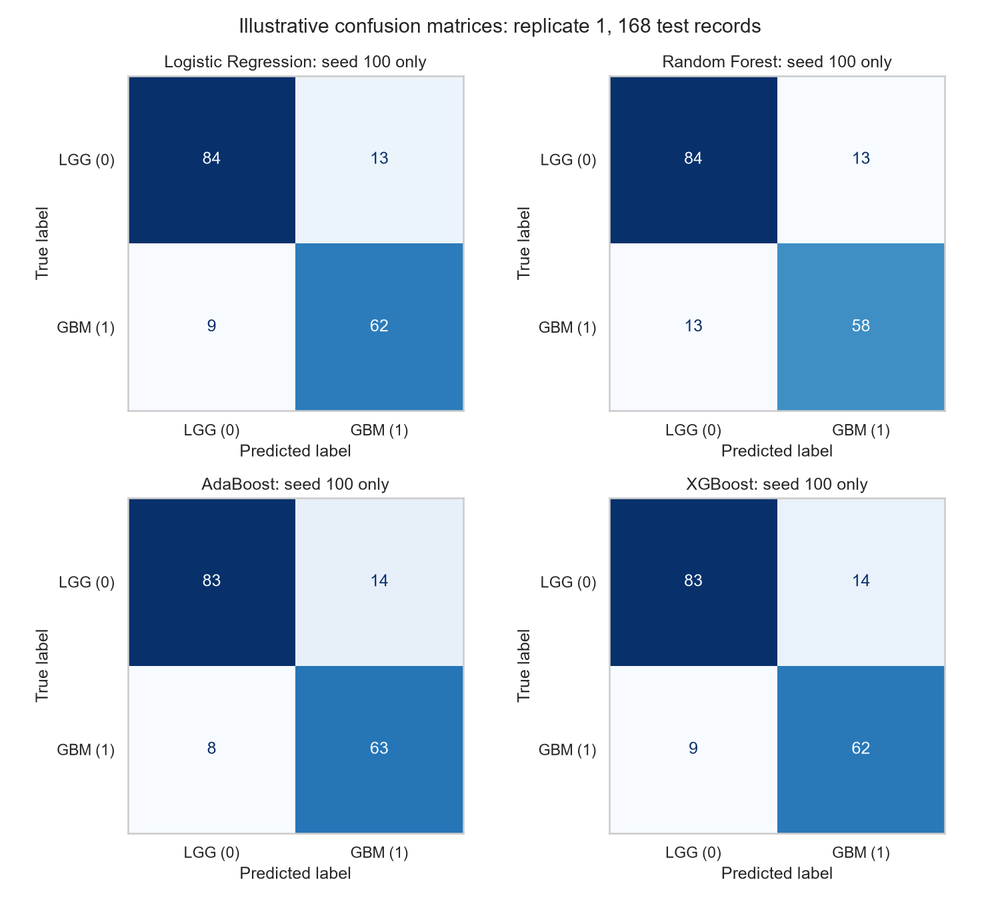

| Model | Correct LGG | LGG predicted GBM | GBM predicted LGG | Correct GBM |
| --- | --- | --- | --- | --- |
| Logistic Regression | 84 | 13 | 9 | 62 |
| Random Forest | 84 | 13 | 13 | 58 |
| AdaBoost | 83 | 14 | 8 | 63 |
| XGBoost | 83 | 14 | 9 | 62 |

## 5. Secondary comparison: mutation features only

I repeated the same searches with only the 20 recorded mutation genes, using
the same people and splits. No random gene selection was used.

| Model | All-feature mean F1 | Gene-only mean F1 | All minus genes |
| --- | --- | --- | --- |
| Logistic Regression | 0.8566 | 0.8578 | -0.0012 |
| Random Forest | 0.8514 | 0.8563 | -0.0049 |
| AdaBoost | 0.8523 | 0.8517 | +0.0006 |
| XGBoost | 0.8517 | 0.8563 | -0.0046 |

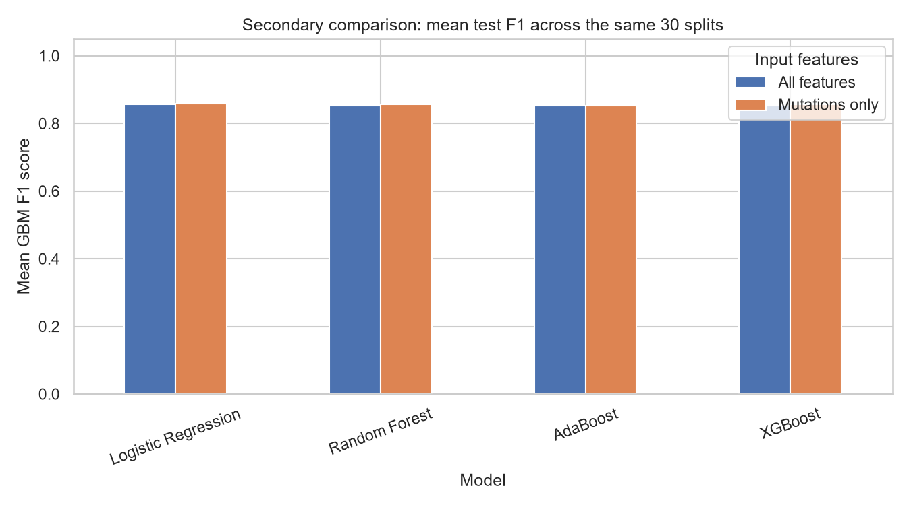

Adding clinical features raised mean F1 for 1 of the four models in
these runs. More features therefore did not give a universal improvement.
These small differences should be read alongside split-to-split variation,
not treated as proof that one feature set is always better.

## 6. Findings, limitations, and conclusion

By the chosen comparison measure, mean test F1, Logistic Regression ranked first among
the four all-feature models. A simple weighted rule may fit the main patterns without learning as much noise as a more flexible model. This is a possible
explanation, not a proven reason. Its mean F1 lead over the next model is only
0.0043; this project does not establish a statistically reliable winner.
Different grids, data, or seeds could change the ranking.

The sample is small and comes from one published dataset. Class sizes differ,
and some race groups have very few records (including one record in one group).
Overall scores do not establish fairness across demographic groups. The dataset
does not provide enough evidence for reliable subgroup conclusions here.
Clinical and genetic records also require privacy protection.

The 30 test groups overlap, so the SD describes changes across splits, not
30 independent studies or a confidence interval. Comparing models using these
test results does not replace evaluation on a new external dataset. Shifts in
who is sampled, measurement methods, or healthcare settings could change results.
No external validation, clinical safety assessment, or fairness study was done.

The project shows how to compare simple tuned classifiers using the same data
splits. All four models were actually trained and evaluated. The scores are useful
for this classroom comparison, but none should make medical decisions on its own.

## Source and reproducibility

Tasci, E., Camphausen, K., Krauze, A. V., and Zhuge, Y. (2022).
*Glioma Grading Clinical and Mutation Features*. UCI Machine Learning Repository.
[Dataset DOI](https://doi.org/10.24432/C5R62J).

Data was loaded through ucimlrepo, dataset ID 759. Model versions are listed in
[requirements.txt](../requirements.txt). See [README](../README.md) for running
instructions, [individual results](../results/model_results.csv), and
[summary statistics](../results/summary_results.csv). The original data is kept
in [glioma.csv](../data/glioma.csv). This draft reflects the saved configuration;
review it if you change the code or rerun with different settings.
